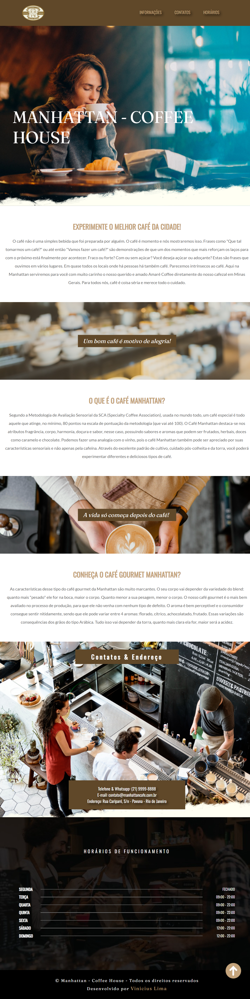

# ☕ Manhattan - Coffee House

Landing page desenvolvida para a cafeteria fictícia Manhattan - Coffee House, com o objetivo de apresentar a identidade da marca, divulgar informações importantes e proporcionar uma experiência digital agradável aos visitantes.

**[Acessar projeto online](https://manhattan-coffee-house-one.vercel.app/)**

---

## 📸 Preview do Projeto

## 📄 Sobre o Projeto

O Manhattan - Coffee House é um projeto desenvolvido com HTML5 e CSS3, simulando o site institucional de uma cafeteria.

A proposta foi construir uma interface visualmente agradável, com navegação intuitiva, organização de conteúdo e adaptação para diferentes tamanhos de tela.

## Funcionalidades e Seções

- Cabeçalho com logotipo e menu de navegação.
- Banner principal de apresentação.
- Seções informativas sobre a cafeteria e seus produtos.
- Banners intermediários com imagens.
- Área de contato com mapa de localização.
- Informações sobre horários de funcionamento.
- Rodapé com identificação do projeto.

## Tecnologias Utilizadas

- HTML5
- CSS3
- Google Fonts
- Design responsivo
- HTML Semântico

## Conhecimentos Aplicados

Durante o desenvolvimento, foram praticados conceitos de:

- Estruturação semântica do HTML.
- Organização de elementos e seções.
- Estilização e posicionamento com CSS.
- Utilização de imagens como elementos visuais.
- Criação de layouts responsivos.
- Organização de arquivos e pastas.

## 💻 Como executar o projeto

1. Faça o download ou clone este repositório.
2. Abra a pasta do projeto.
3. Execute o arquivo `index.html` no navegador.

## 👨‍💻 Desenvolvedor

**Vinicius Lima**

Projeto desenvolvido para fins de estudo e composição de portfólio profissional.

[GitHub](https://github.com/vinils15)
